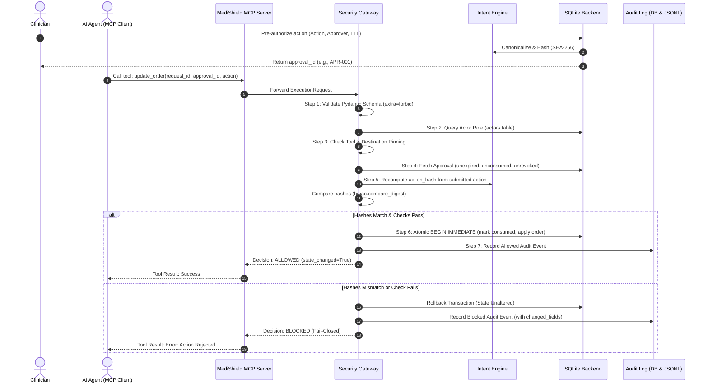
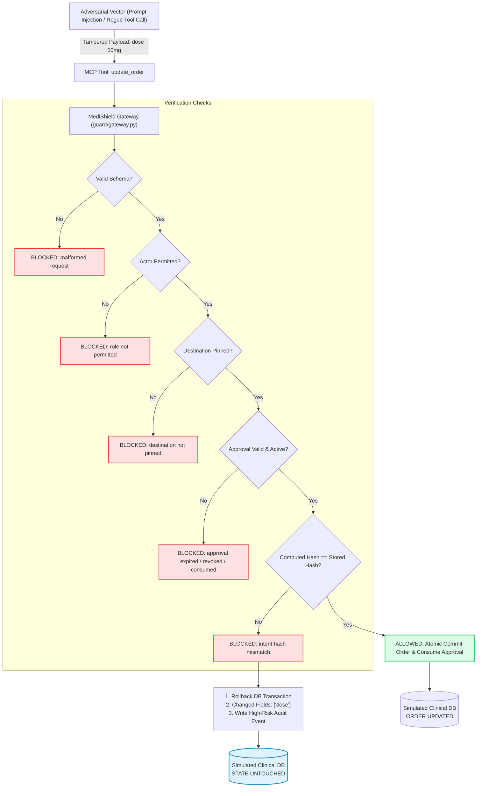

# 🛡️ MediShield: Runtime Security Gateway for MCP-Connected AI Tools

[](https://www.python.org/downloads/)
[](https://modelcontextprotocol.io/)
[]()
[]()

> **Hackathon Prototype & Security Demonstration**
> MediShield is a runtime security gateway designed to secure AI tool execution via the **Model Context Protocol (MCP)**. It acts as an authoritative, fail-closed mediation layer between autonomous AI agents and sensitive simulated clinical backends, preventing parameter tampering, prompt injection tool hijacking, unauthorized role execution, and approval replay.

---

## Table of Contents

- [1. Executive Summary](#1-executive-summary)
- [2. The Problem: The MCP Tool Execution Gap](#2-the-problem-the-mcp-tool-execution-gap)
- [3. What MediShield Solves](#3-what-medishield-solves)
- [4. Core Security Invariants](#4-core-security-invariants)
- [5. System Architecture](#5-system-architecture)
  - [5.1 Component Overview](#51-component-overview)
  - [5.2 Execution Flow Diagram](#52-execution-flow-diagram)
  - [5.3 Adversarial Interception Diagram](#53-adversarial-interception-diagram)
- [6. MCP Server & Tool Contract](#6-mcp-server--tool-contract)
  - [6.1 MCP SDK & Protocol Transport](#61-mcp-sdk--protocol-transport)
  - [6.2 Tool Definitions & Target Destinations](#62-tool-definitions--target-destinations)
  - [6.3 Gateway Mediation Pattern](#63-gateway-mediation-pattern)
- [7. Repository Structure](#7-repository-structure)
- [8. Security Verification Matrix](#8-security-verification-matrix)
- [9. Quick-Start Guide (Windows PowerShell)](#9-quick-start-guide-windows-powershell)
  - [Prerequisites](#prerequisites)
  - [Installation & Setup](#installation--setup)
  - [Running the Security Test Suite](#running-the-security-test-suite)
  - [Launching the Security Dashboard](#launching-the-security-dashboard)
- [10. MCP Inspector & Client Connection Guide](#10-mcp-inspector--client-connection-guide)
- [11. Threat Model & Mitigations](#11-threat-model--mitigations)
- [12. Limitations & Production Roadmap](#12-limitations--production-roadmap)
- [13. Standards & References](#13-standards--references)
- [14. AI Use & Compliance Disclosure](#14-ai-use--compliance-disclosure)

---

## 1. Executive Summary

Autonomous AI agents integrated with external systems through the [Model Context Protocol (MCP)](https://modelcontextprotocol.io/) can generate and trigger sensitive tool calls, such as writing orders, issuing payments, or mutating backend databases. However, LLMs are fundamentally non-deterministic and susceptible to **prompt injection**, **jailbreaking**, **hallucination**, and **context contamination**.

MediShield introduces a **Runtime Security Gateway** and **Deterministic Intent Lock** to MCP tool execution:
1. **Clinician Intent Lock:** High-consequence actions require explicit clinician pre-authorization. The gateway computes an invariant cryptographic digest of canonicalized action parameters.
2. **Runtime Verification:** When an agent invokes an MCP tool, the gateway intercepts the request, independently recomputes the canonical hash, enforces role permissions, checks tool/destination pinning, and validates single-use approval tokens.
3. **Fail-Closed Execution:** Any discrepancy—whether tampered dosage, substituted patient identifier, expired token, or unpinned destination—aborts execution, rolls back state, and generates an audit log entry.

*All data in this demonstration is strictly synthetic and intended for architectural evaluation.*

---

## 2. The Problem: The MCP Tool Execution Gap

The Model Context Protocol standardizes how LLMs interact with external data sources and tools. While MCP standardizes protocol envelopes (JSON-RPC over stdio or SSE), it **does not define application-layer security semantics** for high-risk operations:

- **Parameter Tampering / Confused Deputy:** An LLM might be authorized to invoke `update_order`, but an indirect prompt injection or hallucination causes it to alter critical fields (e.g., changing medication dose from `5 mg` to `50 mg`).
- **Target Substitution:** An agent invokes an approved action against a different recipient (e.g., patient `P-104` substituted for `P-205`).
- **Approval Replay:** A single-use approval token is reused across multiple tool executions without server-side invalidation.
- **Role Elevation:** An untrusted or lower-privilege agent executes high-privilege tools without role validation.
- **Destination Hijack:** Tool definitions redirect queries or state mutations to untrusted third-party endpoints.

MediShield closes this gap by enforcing **authorization boundaries at the MCP tool boundary**.

---

## 3. What MediShield Solves

```
┌────────────────────────────────────────────────────────────────────────┐
│                        UNGUARDED MCP PIPELINE                          │
│                                                                        │
│  [LLM / Agent]  ──(JSON-RPC Tool Call)──▶  [MCP Server]  ──▶ [Backend] │
│   ⚠️ Vulnerable to injection, tampering, replay, & rogue destinations   │
└────────────────────────────────────────────────────────────────────────┘

┌────────────────────────────────────────────────────────────────────────┐
│                      MEDISHIELD GUARDED PIPELINE                       │
│                                                                        │
│  [LLM / Agent]  ──(Tool Call)──▶ [MediShield Gateway] ──▶ [Backend]    │
│                                           │                            │
│                                  1. Schema Validation                  │
│                                  2. Role Verification                  │
│                                  3. Tool & Destination Pinning         │
│                                  4. Intent Lock Hash Match             │
│                                  5. Single-Use Replay Check            │
│                                  6. Atomic DB Mutation                 │
│                                  7. Dual-Store Audit Log               │
└────────────────────────────────────────────────────────────────────────┘
```

MediShield guarantees that **no tool execution takes effect unless it matches an authorized clinician intent byte-for-byte**.

---

## 4. Core Security Invariants

As mandated by our engineering guidelines ([AGENTS.md](AGENTS.md)):

1. **Fail-Closed Architecture:** Any unknown, malformed, expired, revoked, or altered request is rejected. System exceptions abort transactions and write security events.
2. **Never Trust Agent-Supplied Hashes:** The gateway never consumes hashes provided by the AI client. It independently recomputes digests from the submitted payload.
3. **Deterministic Canonicalization:** Canonical JSON sorting, `Decimal`-normalized doses (e.g. `5.0` ➔ `5`), and lowercased units ensure stable, unambiguous hashing.
4. **Timing-Safe Digest Comparison:** Hashes are evaluated using `hmac.compare_digest` to prevent timing side-channel attacks.
5. **Atomic Single-Use Consumption:** Approvals are consumed in the exact same database transaction that applies the backend change.
6. **Immutable Dual-Channel Auditing:** Outcomes (both allowed and blocked) are recorded in SQLite and appended to a persistent JSONL audit trail.

---

## 5. System Architecture

### 5.1 Component Overview

- **Host / MCP Client:** Claude Desktop, an autonomous agent runtime, or test runner communicating over stdio.
- **MediShield MCP Server (`server/mcp_server.py`):** Protocol boundary exposing tools using the official `mcp` Python SDK.
- **Security Gateway (`guard/gateway.py`):** The core enforcement point executing the 8-step verification pipeline.
- **Intent Engine (`guard/intent.py`):** Schema canonicalization (`canonicalize_action`) and SHA-256 digest computation (`action_hash`).
- **Policy Engine (`guard/policy.py`):** Role-based permissions (`TOOL_PERMISSIONS`) and destination pinning (`PINNED_DESTINATIONS`).
- **Simulated Backend (`server/backend.py`, `server/db.py`):** SQLite transactional store for orders, actors, and approvals.
- **Audit Logger (`guard/audit.py`):** SQLite table `audit_events` and append-only log `logs/events.jsonl`.
- **Security Dashboard (`dashboard/app.py`):** Streamlit monitoring console and attack simulation laboratory.

### 5.2 Execution Flow Diagram



### 5.3 Adversarial Interception Diagram



---

## 6. MCP Server & Tool Contract

### 6.1 MCP SDK & Protocol Transport

- **SDK:** Official Python Model Context Protocol SDK (`mcp>=1.9,<2.0`, installed: `mcp 1.30.0`).
- **Standard Transport:** `stdio` (standard input/output JSON-RPC 2.0 frames).
- **Network Transport:** Streamable via Server-Sent Events (SSE) or stdio pipe to local LLM clients.

### 6.2 Tool Definitions & Target Destinations

MediShield manages 5 sensitive clinical MCP tools governed by immutable policy baselines:

| Tool Name | Permitted Roles | Target Pinned Destination | Purpose |
| :--- | :--- | :--- | :--- |
| `update_order` | `agent`, `clinician` | `backend://simulated-ehr/orders` | Mutates a medication order |
| `read_patient_summary` | `agent`, `clinician`, `nurse` | `backend://simulated-ehr/patients` | Reads read-only synthetic patient records |
| `approve_action` | `clinician` | `backend://simulated-ehr/approvals` | Issues a cryptographic intent lock |
| `cancel_order` | `clinician` | `backend://simulated-ehr/orders` | Revokes or discontinues an active order |
| `dispense_simulated` | `clinician`, `pharmacist` | `backend://simulated-pharmacy/dispense` | Triggers simulated medication dispensing |

### 6.3 Gateway Mediation Pattern

When an MCP client invokes `update_order`, the tool payload maps to an `ExecutionRequest` validated by Pydantic:

```python
class ProtectedAction(_StrictModel):
    patient_id: str
    medication_id: str
    dose: str
    units: str
    route: str
    frequency: str
    duration: Optional[str] = None
    order_id: str

class ExecutionRequest(_StrictModel):
    request_id: str
    actor_id: str
    tool: str
    approval_id: str
    action: ProtectedAction
```

---

## 7. Repository Structure

```
Medishield/
├── .gitignore                  # Git exclusions (.venv, *.sqlite3, logs, etc.)
├── AGENTS.md                   # Contributor guardrails, folder ownership, core rules
├── requirements.txt            # Minimal verified dependencies (mcp, pydantic, streamlit, pytest)
├── README.md                   # Project overview, MCP architecture, quickstart
│
├── guard/                      # [Person 1] MediShield Security Gateway & Intent Engine
│   ├── __init__.py             # Security engine package
│   ├── audit.py                # Dual persistence (SQLite audit_events + logs/events.jsonl)
│   ├── gateway.py              # verify_execution() runtime check & atomic transaction logic
│   ├── intent.py               # canonicalize_action() and action_hash() SHA-256 engine
│   ├── models.py               # Strict Pydantic contracts (extra="forbid")
│   └── policy.py               # Role permissions and pinned destination registry
│
├── server/                     # [Person 2] Simulated Clinical Backend & MCP Boundary
│   ├── __init__.py             # Backend package
│   ├── backend.py              # Approval creation, state mutations, order transactions
│   ├── db.py                   # SQLite schema definitions and synthetic seed data
│   └── mcp_server.py           # MCP server protocol entry point
│
├── dashboard/                  # [Person 3] Security Operations Console
│   └── app.py                  # Streamlit real-time monitoring and test lab
│
├── demo/                       # [Person 4] Executable Attack Demonstrations
│   └── attacks.py              # 8 programmatic attack scenarios + 1 control scenario
│
├── docs/                       # Technical Documentation & Architectural Specifications
│   ├── ARCHITECTURE.md         # In-depth architectural flow, sequence diagrams, & contracts
│   ├── CONTRACT.md             # Authoritative audit format and check sequencing
│   ├── MCP_DEMO.md             # Reproducible step-by-step PowerShell testing guide
│   ├── MCP_SPECIFICATION.md    # Model Context Protocol integration specification
│   ├── README.md               # Documentation guide index
│   └── THREAT_MODEL.md         # MCP threat vectors, STRIDE analysis, and mitigations
│
├── logs/                       # Audit log storage
│   ├── sample_events.jsonl     # Sample synthetic audit events
│   └── events.jsonl            # Runtime audit log (generated dynamically)
│
└── tests/                      # Automated Test Suite
    ├── test_attacks.py         # 9 tests verifying adversarial attacks are blocked
    ├── test_backend_audit.py   # 11 tests for approval lifecycles and audit durability
    ├── test_gateway_security.py# 4 tests for gateway authorization & hash verification
    └── test_smoke.py           # Scaffold module import smoke test
```

---

## 8. Security Verification Matrix

All 8 adversarial scenarios and 1 control scenario are implemented in `demo/attacks.py` and systematically validated via `tests/test_attacks.py`:

| Scenario ID | Test Name | Simulated Attack Vector | Expected Decision | Security Rule Enforced | State Changed? |
| :---: | :--- | :--- | :---: | :--- | :---: |
| **01** | `tamper_dose` | Agent modifies dose (`5 mg` ➔ `50 mg`) | **BLOCKED** | `intent hash mismatch` | `False` |
| **02** | `substitute_patient` | Redirects order from `P-104` to `P-205` | **BLOCKED** | `intent hash mismatch` | `False` |
| **03** | `unauthorized_actor` | Nurse attempts to invoke `update_order` | **BLOCKED** | `role not permitted` | `False` |
| **04** | `replay_consumed_approval` | Replays already executed approval token | **BLOCKED** | `approval already consumed` | `False` |
| **05** | `changed_destination` | Destination swapped to unpinned endpoint | **BLOCKED** | `destination not pinned` | `False` |
| **06** | `expired_approval` | Submits token outside validity window | **BLOCKED** | `approval expired` | `False` |
| **07** | `revoked_approval` | Clinician revoked token before execution | **BLOCKED** | `approval revoked` | `False` |
| **08** | `prompt_injection_note` | Indirect injection text placed in patient notes | **ALLOWED** | `intent hash matched` | `True` (Protected fields isolated) |
| **CTRL**| `valid_action` | Exact match with clinician approval | **ALLOWED** | `intent hash matched` | `True` |

---

## 9. Quick-Start Guide (Windows PowerShell)

### Prerequisites

- Windows 10/11 with PowerShell 5.1+ or PowerShell 7+
- Python 3.11 installed (`py --version` or `python --version`)

### Installation & Setup

1. Open PowerShell and navigate to the project directory:
   ```powershell
   cd c:\Users\User\Downloads\Medishield-main\Medishield-main
   ```

2. Create a virtual environment:
   ```powershell
   py -3.11 -m venv .venv
   ```

3. Activate the virtual environment:
   ```powershell
   .\.venv\Scripts\Activate.ps1
   ```
   *(If script execution is disabled on your system, run: `Set-ExecutionPolicy -Scope Process -ExecutionPolicy Bypass`)*

4. Install dependencies:
   ```powershell
   python -m pip install -r requirements.txt
   ```

### Running the Security Test Suite

Run the verified test suite confirming all gateway, backend, and attack scenarios:

```powershell
python -m pytest tests/test_attacks.py tests/test_backend_audit.py tests/test_gateway_security.py -v
```

**Reference test command:**
```text
Run the command in the checkout to obtain the current result; this document does
not hard-code a stale pass count.
```

### Launching the Security Dashboard

To start the real-time Security Operations Center (SOC) dashboard:

```powershell
python -m streamlit run dashboard/app.py
```

The console opens at `http://localhost:8501`, featuring:
- **📊 Overview:** Live metrics (allowed, blocked, warnings, error rate) and operational status.
- **🧪 Security Test Lab:** Interactive buttons to trigger live attacks (`tamper_dose`, `substitute_patient`, `replay_consumed_approval`).
- **🔍 Action Verification:** Playground to inspect canonical JSON sorting and SHA-256 digest output.
- **📜 Audit Log:** Searchable, filterable event explorer reading live SQLite and JSONL events.

---

## 10. MCP Inspector & Client Connection Guide

### Current Server Status

The MCP server exposes the reviewed five-tool surface and applies the Trust
Sentinel, authenticated local-demo context, patient authorization, and gateway
checks before protected handlers run.

### Connecting to MCP Inspector (Target Integration)

Once the stdio tool bindings in `server/mcp_server.py` are active, developers can launch the official Anthropic MCP Inspector:

```powershell
npx @modelcontextprotocol/inspector .\.venv\Scripts\python.exe server/mcp_server.py
```

### Reference Client Configuration (`claude_desktop_config.json`)

To register MediShield with Claude Desktop or any compliant MCP host:

```json
{
  "mcpServers": {
    "medishield": {
      "command": "C:\\Users\\User\\Downloads\\Medishield-main\\Medishield-main\\.venv\\Scripts\\python.exe",
      "args": ["-m", "server.mcp_server"]
    }
  }
}
```

Detailed technical integration notes and tool schemas are documented in [docs/MCP_SPECIFICATION.md](docs/MCP_SPECIFICATION.md).

---

## 11. Threat Model & Mitigations

MediShield targets specific risks identified in the **OWASP Top 10 for LLMs** and **MCP Security Guidance**:

1. **LLM01: Prompt Injection / Tool Argument Manipulation:** An attacker injects instructions into clinical unstructured notes attempting to alter dosages.
   *Mitigation:* Unstructured notes are strictly excluded from the canonical intent lock schema. The gateway compares recomputed digests against the pre-approved baseline.
2. **LLM06: Excessive Agency / Confused Deputy:** An LLM client attempts to perform actions beyond its authorization.
   *Mitigation:* RBAC check (`is_role_permitted`) rejects unauthorized roles before intent verification begins.
3. **Approval Replay:** A compromised agent intercepts a valid approval ID and re-submits it.
   *Mitigation:* The database consumes the approval token atomically (`consumed = 1`) within the update transaction. Replays fail closed.
4. **Tool Destination Spoofing:** A rogue or contaminated tool definition attempts to post clinical records to an unauthorized URL.
   *Mitigation:* Baseline destination registry pins tool destinations to trusted internal URIs (`backend://simulated-ehr/*`).

See [docs/THREAT_MODEL.md](docs/THREAT_MODEL.md) for full STRIDE analysis.

---

## 12. Synthetic privacy workspace

The local MVP also provides a tenant-scoped document vault. TXT and PDF text
can be processed with local rule-based PHI detection; PNG/JPEG files are stored
encrypted but remain manual-review items because OCR is not configured.
Originals and text derivatives use AES-256-GCM, and stored content is
SHA-256-verified before retrieval. The service requires
`MEDISHIELD_DOCUMENT_KEY`; pseudonymization additionally requires the separate
`MEDISHIELD_PSEUDONYM_SECRET`. There is no fallback key.

The dashboard's document workflow uses a local synthetic identity selector,
server-side organization and role checks, signed non-content receipts, and
explicit review gates. These are demonstration controls, not a production
identity provider, complete de-identification, immutable storage, or a
regulatory-compliance claim. Document operations intentionally remain outside
the five-tool MCP registry until a separately reviewed registry update.

## 13. Limitations & Production Roadmap

MediShield is an educational and architectural proof-of-concept. For full production readiness, the following roadmap items are planned:

- **Asymmetric Cryptographic Signatures:** Upgrading approvals from SHA-256 database tokens to Ed25519 public-key signatures issued via clinical smart cards or hardware tokens.
- **Distributed Nonce & Replay Cache:** Replacing local SQLite atomic locking with a distributed Redis/etcd consensus cache for high-throughput multi-node deployments.
- **Enterprise EHR Adapters:** Integrating standard FHIR R4 / SMART-on-FHIR REST endpoints in place of the simulated SQLite backend.
- **Cryptographic Audit Chaining:** Implementing Merkle tree verification or tamper-evident transparency logs for audit events.

---

## 14. Standards & References

- [Model Context Protocol (MCP) Specification](https://spec.modelcontextprotocol.io/)
- [Anthropic MCP Python SDK](https://github.com/modelcontextprotocol/python-sdk)
- [OWASP Top 10 for Large Language Model Applications (2025)](https://owasp.org/www-project-top-10-for-large-language-model-applications/)
- [IETF RFC 8785: JSON Canonicalization Scheme (JCS)](https://datatracker.ietf.org/doc/html/rfc8785)
- [NIST SP 800-207: Zero Trust Architecture](https://csrc.nist.gov/publications/detail/sp/800-207/final)

---

## 15. AI Use & Compliance Disclosure

In strict accordance with the hackathon rules and project conventions ([AGENTS.md](AGENTS.md)):
- **Handcrafted Security Logic:** The two core security functions—canonicalization & hash computation (`guard/intent.py`) and execution verification (`guard/gateway.py`)—were authored by hand.
- **AI Assistance:** AI coding tools were used strictly for scaffolding, documentation drafting, test fixtures, and dashboard presentation.
- **Synthetic Data Notice:** All patient names, medication identifiers, dosages, orders, and clinical records are entirely synthetic.

---

*MediShield — Securing the boundary where autonomous AI meets high-stakes action execution.*
