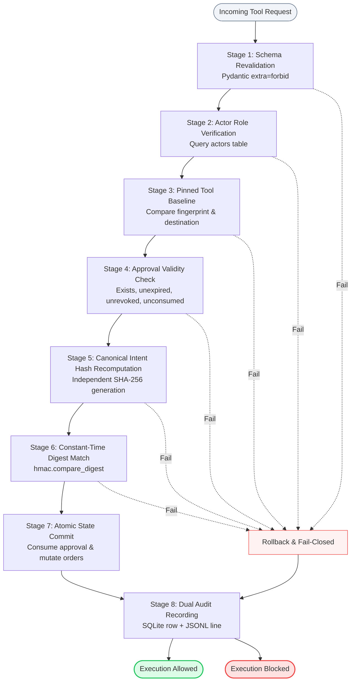
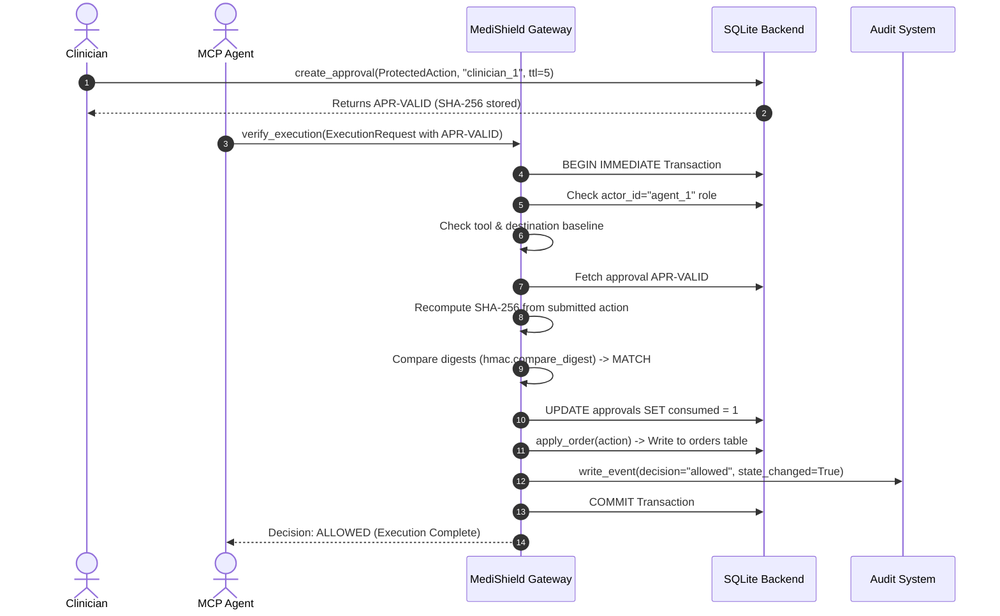
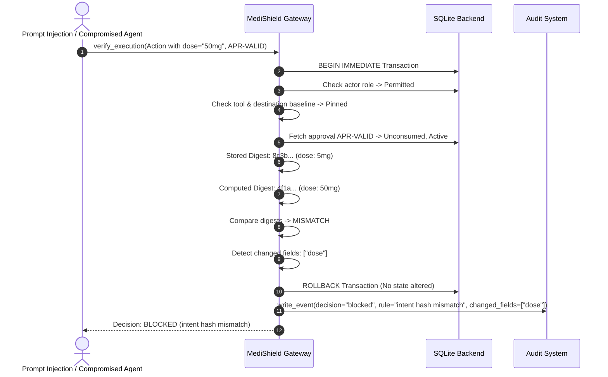
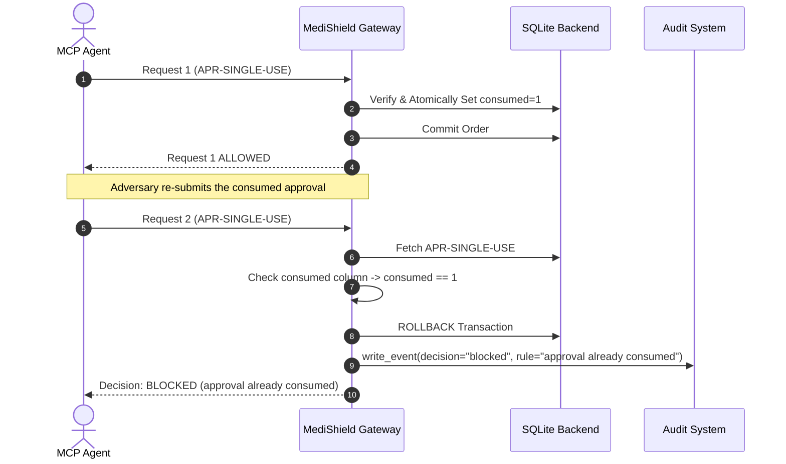

# MediShield Architecture & Engineering Specification

This document details the architectural design, security boundaries, and protocol interactions of **MediShield**, a runtime security gateway for Model Context Protocol (MCP) tool execution.

---

## 1. Architectural Philosophy: The Zero-Trust Tool Gateway

Modern agentic architectures typically connect an LLM host to an MCP server via JSON-RPC. When the model invokes a tool, the server executes it immediately against backend systems. In high-consequence domains (such as healthcare, finance, or infrastructure control), this model suffers from a critical flaw: **the agent is an untrusted, non-deterministic proxy**.

MediShield introduces a **Zero-Trust Tool Gateway Architecture**:
- All tool executions are treated as untrusted requests.
- No sensitive state mutation can occur without an unexpired, unconsumed **Clinical Intent Lock**.
- The gateway acts as an authoritative reference monitor that verifies role permissions, tool baseline integrity, parameter hashes, and single-use constraints within an atomic database transaction.

```
┌─────────────────────────────────────────────────────────────────────────────┐
│                             SECURITY TRUST ZONES                            │
├───────────────────────────────┬─────────────────────────────────────────────┤
│ ZONE 0: UNTRUSTED / ADVERSARIAL│ AI Agent, LLM context, prompt injection,    │
│                               │ unstructured user notes, external tools     │
├───────────────────────────────┼─────────────────────────────────────────────┤
│ ZONE 1: PROTOCOL BOUNDARY     │ Model Context Protocol (MCP) server,        │
│                               │ JSON-RPC request serialization              │
├───────────────────────────────┼─────────────────────────────────────────────┤
│ ZONE 2: MEDISHIELD GATEWAY    │ Invariant reference monitor, schema checks, │
│                               │ intent recomputation, RBAC, destination pin │
├───────────────────────────────┼─────────────────────────────────────────────┤
│ ZONE 3: AUTHORITATIVE BACKEND │ SQLite simulated EHR, atomic commit log,    │
│                               │ persistent dual-channel audit trail         │
└───────────────────────────────┴─────────────────────────────────────────────┘
```

---

## 2. In-Depth Component Breakdown

### 2.1 Protocol Boundary (`server/mcp_server.py`)
- Standardized tool interface communicating with the AI application using the official Python MCP SDK (`mcp 1.30.0`).
- Receives JSON-RPC 2.0 tool calls over `stdio`.
- Deserializes incoming parameters into strict Pydantic execution models.
- Intercepts requests and routes them directly to `guard.gateway.verify_execution`.

### 2.2 Security Reference Monitor (`guard/gateway.py`)
The authoritative decision point. It executes the 8-stage verification pipeline in strict sequence:



### 2.3 Clinical Intent Lock Engine (`guard/intent.py`)
To prevent parameter tampering, MediShield relies on a deterministic hashing scheme:
1. **Model Extraction:** authoritative protected fields are extracted from `ProtectedAction`:
   - `patient_id`
   - `medication_id`
   - `dose`
   - `units`
   - `route`
   - `frequency`
   - `duration`
   - `order_id`
2. **Numeric Normalization:** `dose` is parsed into Python's `Decimal` type and normalized (e.g., `"5.00"` ➔ `"5"`), eliminating whitespace and scientific formatting differences.
3. **Unit Normalization:** `units` is cast to lower-case (e.g., `"MG"` ➔ `"mg"`).
4. **Canonical JSON Serialization:** Keys are sorted alphabetically with compact delimiters (`separators=(',', ':')`) and UTF-8 encoding.
5. **SHA-256 Digest:** The canonical string is digested using SHA-256 into a 64-character hexadecimal representation.

```python
# Conceptual canonical representation:
{"dose":"5","duration":"7 days","frequency":"daily","medication_id":"MED-A","order_id":"ORD-DEMO-001","patient_id":"P-104","route":"oral","units":"mg"}
```

### 2.4 Policy Baseline & Destination Registry (`guard/policy.py`)
To mitigate **Confused Deputy** and **Tool Poisoning** attacks:
- **Role Permissions:** Restricts tools to specific actor roles. For example, `cancel_order` is restricted strictly to `clinician`, whereas `update_order` allows `agent` and `clinician`.
- **Destination Pinning:** Every tool is bound to an immutable URI destination (e.g. `backend://simulated-ehr/orders`). If an agent attempts to invoke a tool with an unpinned destination, the gateway aborts execution with `destination not pinned`.

### 2.5 Dual-Persistence Audit Engine (`guard/audit.py`)
Every decision (allowed, blocked, or warning) generates an immutable structured audit event containing 12 authoritative fields:
- `time`: ISO-8601 UTC timestamp with `Z` suffix.
- `request_id`: Unique execution identifier.
- `actor`: Caller identifier (e.g. `agent_1`, `clinician_1`).
- `tool`: Invoked MCP tool name.
- `action_type`: Specific action category.
- `approval_id`: Associated intent lock token.
- `decision`: `allowed`, `blocked`, or `warning`.
- `risk`: `low`, `medium`, or `high`.
- `rule`: Specific security rule that governed the decision.
- `reason`: Plain-language explanation for clinical review.
- `changed_fields`: List of protected attributes that deviated from approval.
- `state_changed`: Boolean indicating if backend tables were mutated.

Audit writes are synchronized across **SQLite** and an append-only **JSONL file** (`logs/events.jsonl`).

---

## 3. Sequence Diagrams

### 3.1 Legitimate Pre-Authorized Tool Execution



### 3.2 Adversarial Interception: Tampered Dose



### 3.3 Replay Attack Rejection



---

## 4. Database Schema Specification

```sql
-- Authorized actors and their organizational roles
CREATE TABLE IF NOT EXISTS actors (
    actor_id TEXT PRIMARY KEY,
    role TEXT NOT NULL
);

-- Synthetic patient directory
CREATE TABLE IF NOT EXISTS patients (
    patient_id TEXT PRIMARY KEY,
    name_synthetic TEXT NOT NULL
);

-- Pre-authorized clinical intent locks
CREATE TABLE IF NOT EXISTS approvals (
    approval_id TEXT PRIMARY KEY,
    action_hash TEXT NOT NULL,
    action_json TEXT NOT NULL,
    approver_id TEXT NOT NULL,
    created_at TEXT NOT NULL,
    expires_at TEXT NOT NULL,
    revoked INTEGER NOT NULL DEFAULT 0,
    consumed INTEGER NOT NULL DEFAULT 0
);

-- Simulated medication order state
CREATE TABLE IF NOT EXISTS orders (
    order_id TEXT PRIMARY KEY,
    patient_id TEXT NOT NULL,
    medication_id TEXT NOT NULL,
    dose TEXT NOT NULL,
    units TEXT NOT NULL,
    route TEXT NOT NULL,
    frequency TEXT NOT NULL,
    duration TEXT
);

-- Immutable audit event record
CREATE TABLE IF NOT EXISTS audit_events (
    id INTEGER PRIMARY KEY AUTOINCREMENT,
    time TEXT NOT NULL,
    request_id TEXT NOT NULL,
    actor_id TEXT NOT NULL,
    tool TEXT NOT NULL,
    action_type TEXT NOT NULL,
    approval_id TEXT,
    decision TEXT NOT NULL,
    risk TEXT NOT NULL,
    rule TEXT NOT NULL,
    reason TEXT NOT NULL,
    changed_fields TEXT NOT NULL,
    state_changed INTEGER NOT NULL
);

-- Registered tool destinations and baseline fingerprints
CREATE TABLE IF NOT EXISTS tool_baseline (
    tool_name TEXT PRIMARY KEY,
    fingerprint TEXT NOT NULL,
    allowed_destination TEXT NOT NULL
);
```

---

## 5. Security & Concurrency Design

### 5.1 Atomic Immediate Transactions
To prevent **Time-of-Check to Time-of-Use (TOCTOU)** race conditions:
- The gateway acquires an exclusive SQLite lock via `BEGIN IMMEDIATE` prior to evaluating approval status.
- The approval consumption (`consumed = 1`) and the order insertion/mutation (`apply_order`) execute within the same transactional unit.
- If any stage errors or hash verification fails, `ROLLBACK` restores the database to its pristine pre-request state.

### 5.2 Constant-Time Comparisons
Hashes and destinations are evaluated using Python's standard `hmac.compare_digest`. This eliminates microarchitectural timing side-channels that could otherwise allow an attacker to progressively guess cryptographic digests or tokens.
